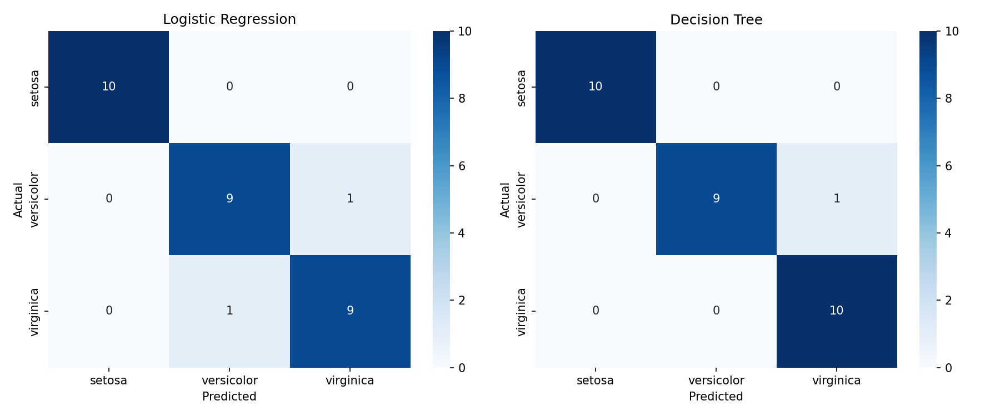
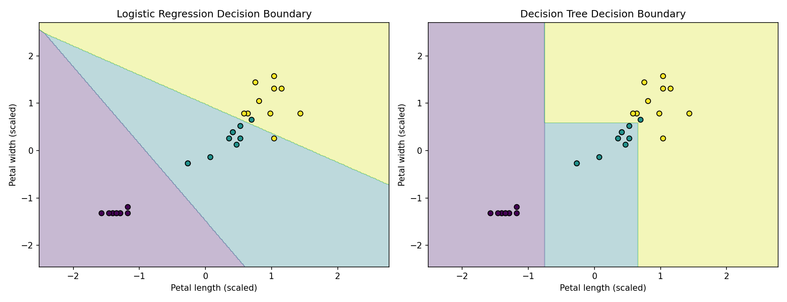

# Task 1: Iris Classification
# Task 1: Multi-Class Classification Pipeline (Iris Dataset)

**Goal:** Build an end-to-end classification pipeline with Scikit-Learn to
predict iris flower species, and compare Logistic Regression with a Decision Tree.

## What I did

1. Loaded the Iris dataset with Pandas and explored it with a Seaborn pairplot
2. Split the data 80/20 into train and test sets (stratified, `random_state=42`)
3. Scaled the features with `StandardScaler`, fitted on the training data only to avoid data leakage
4. Trained Logistic Regression and Decision Tree (`max_depth=3`) models
5. Evaluated with accuracy, precision, recall and F1-score
6. Plotted confusion matrix heatmaps and decision boundaries

## Results

| Model | Accuracy | Errors (out of 30) |
|---|---|---|
| Logistic Regression | 93.3% | 2 |
| Decision Tree | 96.7% | 1 |

- Setosa was classified perfectly by both models.
- All mistakes were between versicolor and virginica, which overlap in their petal measurements.
- The accuracy gap is only one test sample, so the two models perform comparably.

## Files

| File | Description |
|---|---|
| `iris_classification.ipynb` | Main notebook with code, outputs and conclusions |
| `iris.csv` | Dataset |
| `pairplot.png` | Exploratory pairplot |
| `confusion_matrix.png` | Confusion matrix heatmaps for both models |
| `decision_boundary.png` | Decision boundary plots (petal length vs petal width) |

## Visuals

